# Architecture and threat model

## Data flow

```mermaid
flowchart LR
 Page[Selected HTML tab] --> Capture[Isolated capture and identity checks]
 Capture --> Local[Panel memory: original image and fields]
 Local --> Sanitize[Suppress all raw pixels and text]
 Sanitize --> Review[Exact request review]
 Review --> Gate[One-use outbound gateway]
 Gate --> Model[Simulator or local Ollama]
 Model --> Proposal[Untrusted structured proposal]
 Proposal --> Policy[Task, field, origin, document and token checks]
 Policy --> Insert[Local insertion]
 Insert --> Verify[Independent readback]
 Verify --> Capture
 Verify --> Receipt[Safe event receipts]
```

## Module boundaries

- `browser.ts`: Chrome API access, document identity, mutation revision, exclusions, element-bound field keys and insertion readback.
- `sanitizer.ts`: generated safe field descriptions; full opaque pixel suppression; experimental pattern detector, not the privacy boundary.
- `tokens.ts`: random one-use references, memory-only values, task/origin/field/document/policy/expiry checks.
- `gateway.ts`: the only model-bound fetch; exact serialized request, trusted in-process ticket registry, one-use ticket, freshness callback, timeout and strict response parser. Caller-set booleans are not accepted as proof of sanitization.
- `session.ts`: orchestrates policy, states, review, capture, proposed/attempted/verified actions and receipts. Trusted extension code creates tickets; untrusted page/model data never calls the ticket issuer directly. This assumes the extension bundle is trusted.
- `panel.ts`: local controls and previews. Never interprets raw page content as HTML.
- `background.ts`: opens the panel. No raw values in restartable worker state.

## Trust boundary

Pages and model replies are untrusted. The user grants insertion permission in the extension's own UI. Page instructions cannot add a permission. Raw page labels, URLs, queries, values, hidden attributes, errors and histories are never included in model text. There is no general natural-language task box, because it could carry secrets. Purpose is the fixed `fill-approved-fields` action. Screenshots are fully suppressed; Ollama receives no image at all. This sacrifices most visual utility.

A token names a value but does not grant permission by itself. Each grant is bound to one task, one document, one origin, one actual field and one policy version. The local store consumes the token before insertion. A failure does not permit replay. Clearing/reloading/aborting invalidates local mappings. Lost mappings require fresh input and approval.

Capture identities include selected tab/window, Chrome documentId, origin, hashed URL, viewport, scroll, device scale, zoom and observed generation. URL hashes remain local. Hashes are not a privacy guarantee for guessable inputs. Any mismatch blocks. Browser events cannot form a fully atomic transaction with a hostile website; checks narrow the race, not freeze the page.

Pause/abort stop new operations and cancel in-flight network requests. A local insertion already dispatched to Chrome may finish before cancellation is observed. Check the destination after an interrupted attempt. No success is recorded from a model claim alone. A verified event means point-in-time readback, not submission or durable website storage.

## Supported pages

| Area | Current behavior |
|---|---|
| Top-frame HTTP(S) standard text/email/tel input, textarea | Capture; explicit permitted insertion and readback |
| Select, number, checkbox, password, file fields | Some metadata may be observed; insertion not supported |
| Page text, tables, cards | Raw text excluded; screenshots entirely masked |
| CSS-selector manual exclusions | Matching elements and descendants removed from available fields |
| Dynamic DOM, replacement fields, navigation, scroll, zoom | Identity changes invalidate; bounded capture retries |
| Cross-origin frames, canvas, image text, video, embedded documents | No field interaction/OCR; full image suppression protects exported image |
| Shadow content and complex visual effects | Flagged unsupported; no claim of selective visual coverage |
| Large pages | Bounded limits; failure blocks |
| Other browser traffic, other agents, native apps | Outside boundary |

## Explicit non-guarantees

This protects only inputs routed through this extension's integrated pipeline. It does not intercept all browser traffic or other screenshot tools. It cannot hide an inserted value from the destination website, protect a compromised OS/browser/extension, identify every secret, or provide universal screenshot protection. Coarse field types/categories and counts remain disclosed. Detector quality is not proven by full image suppression.

## Retention and logging

Raw observations and token values live only in panel memory and the page's ordinary DOM. No extension storage, analytics, telemetry or secret logs. Receipts contain timestamps, random task/capture IDs, route, policy version, event and fixed error codes. They omit values, labels, URLs, model free text and screenshot bytes. Receipts are memory-only and can be cleared. Test artifacts contain synthetic data only and stay under ignored `output/`.
